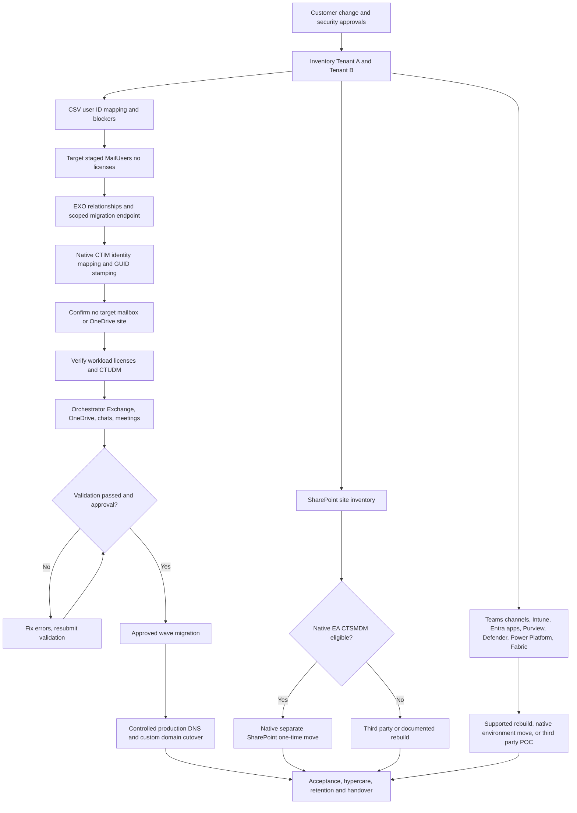

# Architecture and execution flow

**Scoping:** Commercial Microsoft 365 cloud-only tenants A and B, not on-prem AD / Exchange hybrid, not Azure subscription migration.



**No magical universal transaction:** The arrows are dependency order, not proof every workload migrates. A native OneDrive, mailbox or SharePoint move can be one-way; source deletion, redirect preservation and service-level evidence must be managed explicitly. Graph beta orchestrator exposes user workload migration, not a complete all-service move.

## Ownership and privileges

| Actor | Access | Gate |
|---|---|---|
| Customer sponsor/change manager | Approved scope and maintenance | Signed business authorization |
| Source tenant Entra + EXO admins | Inventory, scoped org relationship, CTIM source copy | Source tenant ID and role verified |
| Target tenant Migration Admin/EXO/SharePoint admins | Target foundation, CTIM accept/write, orchestration | Target tenant ID, least privilege, module version pinned |
| Compliance/legal owner | Holds, Purview, retention, evidence | No automatic hold removal or deletion |
| DNS owner | Domain zone export, TTL, production record changes | Domain release and external mail-flow GO |
| Endpoint owner | Intune re-enrollment, encryption recovery and policy tests | Pilot devices + user coordination |
| Application owners | Enterprise apps, SSO/SCIM/OAuth, agents, flows | Vendor collaboration and sign-in tests |
| Finance/CSP partner | SKU / EA eligibility / purchased add-ons | Verified purchase and budget approval |

## Key design choices

1. Use delegated Graph sessions for read-only inventory; handle partial API failures as blockers.
2. Externalize configuration; keep all customer exports in `output/`, never in Git.
3. Use **Entra object GUIDs**, not AD SIDs or mutable UPN alone, for native migration identity mapping; new target IDs are mandatory.
4. Do not store plaintext/hashed source passwords: users reset or receive controlled temporary access after cutover.
5. Use Microsoft's CTIM module for GUID/X500 stamping rather than a hand-written Graph PATCH that risks unsupported Exchange attributes.
6. Separate read-only inventory, pilot/validation, production execution, DNS and irreversible customer actions. No automated 'run everything' command can safely perform these without approvals.


## Central operator entry point (October 2026 refactor)

```text
Operator (pwsh ./main.ps1  OR  ./main.ps1 -Stage <name>)
          |
          v
modules/Migration.Workflow.psm1
  |-- verify config + source != target
  |-- resolve paths relative to repo root
  |-- choose exactly one stage / guided menu
  |-- invoke helper in fresh pwsh process per stage
  |-- reject nonzero helper exit; check Graph manifests
  |-- never skip approval gates for tenant mutations
          |
          +--> scripts/Export-GraphInventory.ps1        [read only]
          +--> scripts/Export-ServiceInventory.ps1      [read only]
          +--> scripts/New-IdentityMap.ps1               [local CSV]
          +--> tools/assess.py                          [local JSON]
          +--> scripts/Test-DnsReadiness.ps1             [read only]
          +--> scripts/New-CloudTargetUsers.ps1          [approved write]
          +--> scripts/Invoke-Ctim.ps1                   [approved write/phase]
          +--> scripts/Test-TargetMailboxReadiness.ps1   [read only]
          +--> scripts/Invoke-NativeOrchestrator.ps1     [preview + approved write]
```

**Do not combine tenant admin sessions in one long-lived PowerShell process**;
CTIM in particular requires fresh authentication context. This modular dispatcher
starts new PowerShell child processes for every script. The `AllReadOnly` chain
cannot perform writes and stops on failed Graph collections. Non-read-only
migration phases are deliberately independent with customer approval checks.
